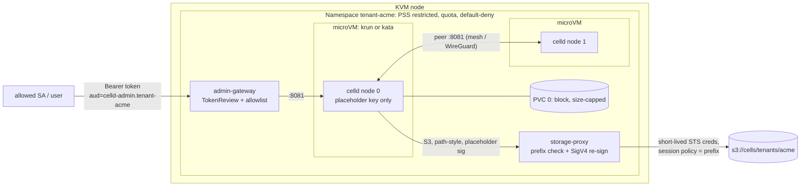

# Tenant isolation: design and threat model

A `Tenant` (cluster-scoped) wraps one tenant's Durable Objects fleet in an
isolation boundary. It owns a namespace that holds a microVM-backed
`WorkerApp`, a default-deny network, a prefix-scoped signing storage proxy,
hard resource limits, and an authenticated path to the admin API. The
WorkerApp controller is reused unchanged apart from three opt-in fields
(see the PR description for every upstream touch point). Facts this design
relies on are verified, with sources, in [FINDINGS.md](FINDINGS.md).



## Threat model

**Adversary.** Tenant-supplied Worker code (JavaScript or Wasm) running in
celld's V8 isolates. We assume it achieves arbitrary code execution in the
celld process, because V8 escapes are a recurring bug class. A second
adversary is another tenant trying to reach this tenant's data, compute
or admin API.

**Assets.** Other tenants' Durable Object state (bucket objects and node
volumes); bucket credentials; the host kernel and kubelet; the cluster
control plane; node capacity shared with other tenants.

**Out of scope.** A malicious cluster administrator, a compromised
operator, compromised storage, and denial of service against the tenant
itself.

### Escalation path and what each layer stops

| # | Layer | The attacker has, after breaching the previous layer | This layer stops | It does not stop |
|---|---|---|---|---|
| 0 | V8 isolate (celld) | Worker JS | Direct syscalls and reads of process memory | V8 bugs. celld runs one app per fleet, so isolates only separate objects *of the same tenant*. |
| 1 | celld process in the guest | Code exec as uid 10001 in the guest. Sees the placeholder key, its own PVC, and the guest's view of the pod network. | Nothing between tenants: this is still the tenant's own VM | Reading the tenant's own data (expected) |
| 2 | **microVM (KVM)** | Guest kernel exploit, so guest root | Host kernel exploits: the guest kernel is not the host kernel, and the syscall surface becomes the VMM's virtio device surface plus KVM | VMM bugs (virtio-fs, vsock/TSI, net, console) and KVM bugs |
| 3 | Host container sandbox around the VMM | With krun: code exec in the VMM process, which **is** the container process. With kata: code exec in the host VMM process (QEMU or Cloud Hypervisor), outside the pod sandbox. | krun: seccomp RuntimeDefault, all capabilities dropped, non-root uid, read-only root filesystem, the pod's namespaces and cgroups. The PSS `restricted` namespace label forbids anything weaker. | Kernel exploits from inside the container sandbox. For kata this layer is whatever sandbox the kata VMM runs in (see residual risk R1). |
| 4 | **Network** (NetworkPolicy; mesh or WireGuard) | Any packet the pod network namespace can send. Under krun, TSI proxies guest sockets through the VMM in the pod netns, so the policy still applies. | Reaching other tenants' pods, proxies and gateways; the store directly; cloud metadata (169.254.0.0/16) and with it the node's IAM role; anything except own peers, own proxy and DNS. Mesh or WireGuard stops sniffing and spoofing of plaintext peer traffic. | DNS-based exfiltration through cluster DNS; reaching own-tenant services (expected) |
| 5 | **Storage proxy + scoped credentials** | A route to the tenant's own proxy | Reads and writes outside `bucket/prefix`, enforced on the path, list prefix, DeleteObjects body, `x-amz-copy-source`, and dot segments. ACL, policy, versioning and lock changes. Theft of a reusable credential: the VM holds only a placeholder, the proxy holds a ≤1 h STS credential narrowed by a session policy, and the store enforces the same prefix a third time. | Corruption or deletion of the tenant's own objects; requests that look like a node's (see R4) |
| 6 | **Resource limits** | Arbitrary CPU and memory use in its VMs | CPU: the cgroup quota from the LimitRange default limit (the per-node hard CPU limit). Memory: VM RAM equals the memory limit. Disk: a block-backed PVC whose filesystem size is a hard cap; ephemeral-storage limits; the namespace ResourceQuota (CPU, memory, storage, PVC count, pods, no LoadBalancer or NodePort). This bounds noisy-neighbor impact. | Fairness inside the tenant: celld's per-request CPU budget is still wall-clock, and one object can fill its node's PVC (R6) |
| 7 | **Admin API** | n/a: an outside party trying to use `:8081` | Unauthenticated access. `:8081` is ClusterIP/headless only. The gateway accepts only Kubernetes tokens minted for `celld-admin.<namespace>` (TokenReview with audience), only from allowlisted principals, and never forwards the token. In Istio mode an AuthorizationPolicy allows only the listed SPIFFE principals. | An allowed admin (admin = full tenant control, including `/cell/` and `/do/`) |
| 8 | **Kubernetes control plane** | n/a | Tenant pods carry no API token (`automountServiceAccountToken: false`; only the proxy carries a projected, STS-audience token). Tenant objects are operator-owned, and creating a Tenant is a cluster-admin action. | Tenant users who are *also* granted pod-create RBAC in the tenant namespace (R4) |

### How this answers celld's known gaps

| celld gap | Mitigation here | Remaining |
|---|---|---|
| Unauthenticated admin port | Layer 7: ClusterIP-only listener, NetworkPolicy, authenticating gateway or Istio AuthorizationPolicy | The upstream port is still unauthenticated *inside* the namespace: fleet peers can call each other's admin API (same tenant) |
| Plaintext peer traffic | Istio ambient (`--tenant-peer-encryption=istio-ambient` labels the namespace and sets PeerAuthentication STRICT) or Cilium WireGuard (declared). Reported as the `PeerEncryption` condition. | With `none` (the default) traffic is plaintext, and the condition says so |
| Inter-node trust rides on the bucket credential | The VM no longer holds a bucket credential. Node authority is "can reach this tenant's proxy", which NetworkPolicy limits to the fleet's own pods. | See R4 |
| Wall-clock-only CPU budget | A hard cgroup CPU limit per node bounds the tenant's total CPU | Per-request fairness within a tenant |
| No per-object disk cap | A per-node, size-capped block PVC bounds the blast radius to one tenant's node | One object can still exhaust its node's volume (R6) |

## Residual risks

**R1. The libkrun VMM shares a security context with the guest.** With
krun, the VMM is the container's own process: same uid, seccomp profile,
namespaces and cgroup as the workload. There is no separate jailer, and
the guest's devices are emulated in that process. That includes virtio-fs
over the container root filesystem and TSI, which performs the guest's
socket calls on the host. A VMM escape is therefore code execution as the
container on the host. Layer 3 still applies: non-root, no capabilities,
RuntimeDefault seccomp. But there is exactly one boundary between "guest
root" and "host container". Kata's VMM runs outside the pod sandbox, often
as root. It has a different shape but is not strictly better unless kata
is configured with a hardened, non-root VMM. Mitigations: dedicated KVM
node pools per trust tier (taint `celld-operator.io/microvm`); keep libkrun
and libkrunfw current; consider kata with Cloud Hypervisor and seccomp for
the highest tier.

**R2. SIGTERM is not delivered under krun.** This is an availability
risk, not an isolation one. Kubelet's SIGTERM never reaches celld, so a
pod stop waits out the 60 s grace period and is SIGKILLed. Durable
Objects then move only after their leases expire (FINDINGS.md section 4).
Mitigation for celld: package it with `STOPSIGNAL SIGINT`
(`hack/isolation/celld-stopsignal`). workerd cluster mode drains only on
SIGTERM, so it needs the libkrun change proposed in
[upstream/libkrun-sigterm-forwarding.md](upstream/libkrun-sigterm-forwarding.md),
or kata.

**R3. Pod-network encryption is declared, not verified.** The operator
configures Istio ambient itself, but for Cilium WireGuard it trusts
`--tenant-peer-encryption`. If the CNI does not encrypt, peer, proxy and
admin traffic (bearer tokens included) is plaintext on the node network.

**R4. The proxy authenticates by network position.** Any pod matching the
fleet selector in the tenant namespace can use the proxy as the tenant.
Kubernetes RBAC is the only thing stopping a tenant *user* from creating
such a pod, and that pod would still be confined to the tenant's own
prefix. Do not grant tenant users pod-create in their Tenant namespace.
Hardening option with Istio: an AuthorizationPolicy on the proxy that
admits only the fleet ServiceAccount's principal.

**R5. The proxy and gateway run on the shared host kernel** (runc) by
default. They run trusted code, but they parse tenant-controlled HTTP and
XML, and the proxy holds the tenant's short-lived credential.
`--tenant-proxy-runtime-class` moves them into a microVM as well.

**R6. No per-object disk cap.** Inside a tenant, one Durable Object can
fill its node's volume and degrade that tenant's other objects. The PVC
cap keeps this inside the tenant.

**R7. Shared hardware.** Tenants' VMs share CPUs, caches and memory
controllers on a node. Microarchitectural side channels across VMs are
not addressed. Use node pools or dedicated nodes per tenant tier where
that matters.

**R8. Shared bucket.** All tenants can live in one bucket, isolated by
prefix at three points: the proxy, the session policy and the store's IAM.
A role whose trust policy admits every tenant proxy's ServiceAccount,
combined with `scopeSessionPolicy: false`, collapses that to the proxy
alone. Use one role per tenant, trusted only for
`system:serviceaccount:tenant-<name>:storage-proxy`.

**R9. A highly privileged operator.** The operator creates namespaces,
writes Secrets in any namespace, and can bind `system:auth-delegator`. A
compromised operator is a compromised cluster. This was already true of
the WorkerApp operator; the Tenant controller widens it.

**R10. DNS stays open.** Fleet pods can query cluster DNS, which reveals
Service names in other namespaces and is a low-bandwidth exfiltration
channel. Peer discovery needs it.

**R11. Data outlives the Tenant.** Deleting a Tenant garbage-collects its
namespace, PVCs included, but leaves the bucket prefix in place on
purpose. Purge it separately.

**R12. `kubectl exec` under krun runs on the host side.** It enters the
container's namespaces outside the VM. It cannot see the guest, and it is
not a guest escape, but cluster admins should not mistake it for
inspection of the workload.

## Runtime swappability (celld → workerd cluster mode)

Only `Workload` (`internal/controller/tenant/workload.go`) knows which
runtime is in the VM. Everything else in the boundary is runtime-agnostic:
namespace, quota, LimitRange, network policy, storage proxy, admin gateway,
RuntimeClass and peer encryption.

| Concern | celld (implemented) | workerd cluster mode (planned) |
|---|---|---|
| Fleet object | WorkerApp (reused, with its rollout and drain guardrails) | A StatefulSet rendered by a `workerdWorkload`, or WorkerApp once it learns `engine` |
| S3 endpoint | `S3_ENDPOINT` = proxy URL (path-style) | `ClusterConfig.bucketOptions: aws_endpoint=<proxy URL>` (path-style, `cluster/s3.rs`) |
| Credential | Placeholder in `AWS_ACCESS_KEY_ID` / `AWS_SECRET_ACCESS_KEY` | Placeholder in `aws_access_key_id` / `aws_secret_access_key` (required by workerd) |
| Conditional writes | `If-None-Match: *` / `If-Match`; the proxy passes them through | The same headers |
| Peer port / admin | `:8081` (peers and admin on one listener) | `--cluster-addr` (peers); `/ready` for readiness |
| Inter-node secret | none | `ClusterConfig.key`: a Secret in the VM (not a bucket credential) |
| Graceful stop | SIGTERM or SIGINT; under krun use `STOPSIGNAL SIGINT` | SIGTERM only: needs the libkrun fix or kata |

`spec.engine` exists now (enum: `celld`), so adding `workerd` is an
additive API change. The e2e suite's isolation assertions are written
against the boundary, not the runtime, so they carry over.

## Operating it

```sh
helm/kustomize install as usual, then add to the manager:
  --enable-tenants
  --tenant-proxy-image=<registry>/celld-operator-isolation-proxy:<tag>
  --tenant-peer-encryption=istio-ambient|cilium-wireguard
  --tenant-storage-class=<block-backed class>
  --allowed-image-prefixes=<registry>/celld:      # STOPSIGNAL SIGINT build
kubectl apply -k config/isolation/runtimeclass    # after preparing KVM nodes
kubectl apply -f config/samples/v1alpha1_tenant.yaml
kubectl get tenants
kubectl create token celld-admin -n platform-ops --audience celld-admin.tenant-acme
```

The operator must run cluster-wide (`--watch-namespace` unset) and can
build the proxy image from `Dockerfile.isolation-proxy`.
